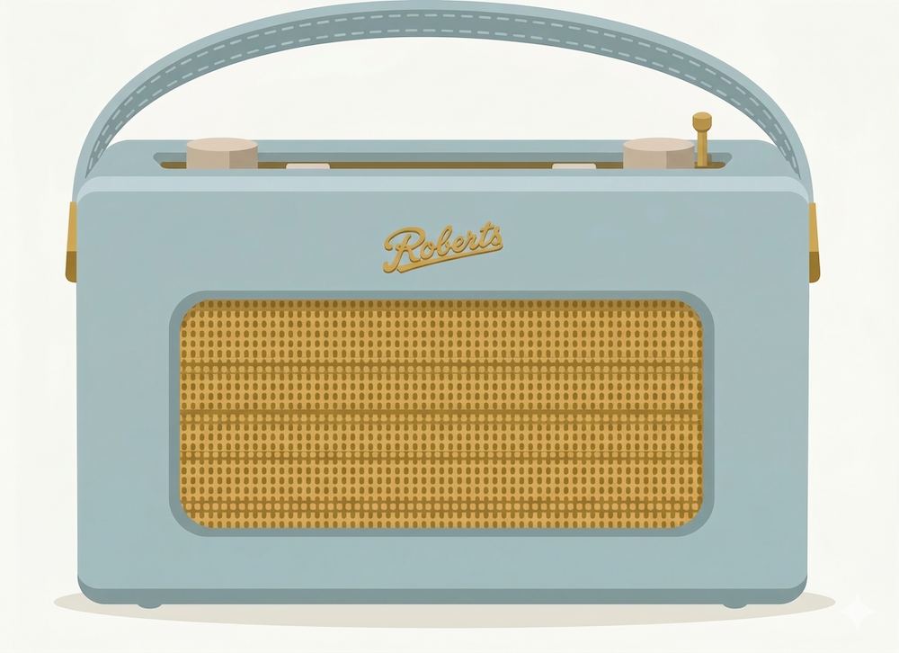
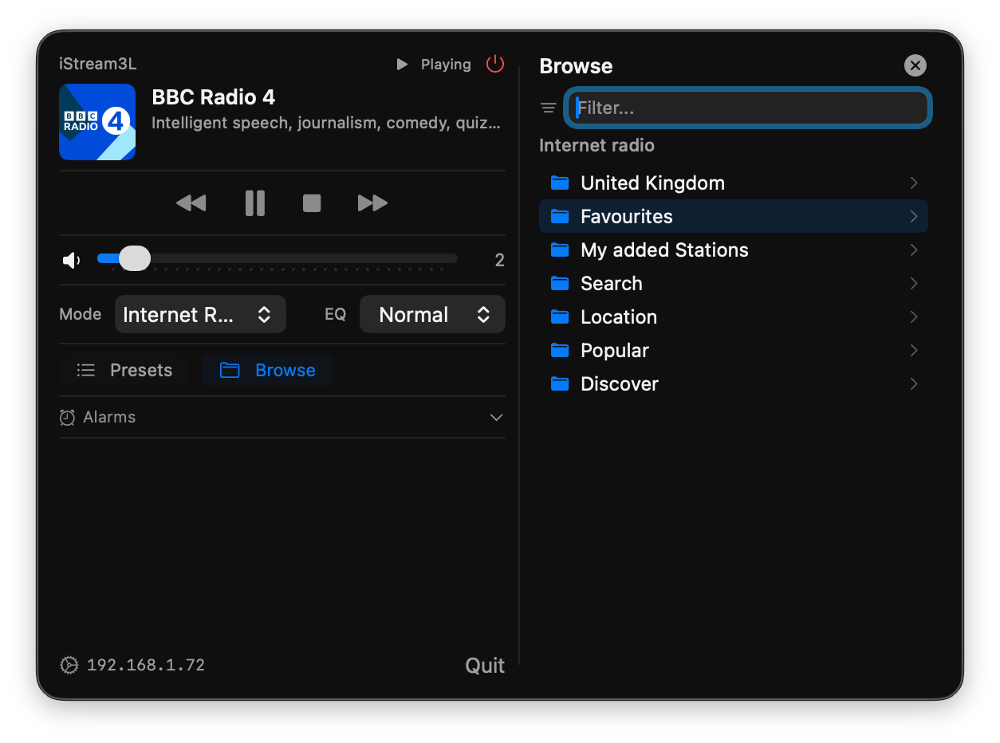

# RadioBar




A macOS menubar app for controlling a Roberts Revival iStream 3L internet radio over the local network.

Built on the community-reverse-engineered [FSAPI protocol](docs/fsapi-reference.md) used by Frontier Smart-based radios, so *should* also work with other Radios.



## Features

- Now playing: track name, artist, artwork, progress
- Playback controls that follow what the current source supports
- Volume slider with mute
- Mode switching (Internet Radio, Podcasts, DAB, FM, Spotify, etc.)
- EQ presets
- Preset selection per mode
- Browse stations and podcasts with live filter
- Seek where the source supports it (click the progress bar)
- Spotify Connect account info
- Alarm display
- Finds the radio on your network and reconnects automatically
- Mac Audio: one button to play your Mac's audio through the radio over Bluetooth
- Configurable IP and PIN

## Install

Download `RadioBar.zip` from [Releases](../../releases), unzip, and drag `RadioBar.app` to your Applications folder. The app is signed and notarized, so it will run without Gatekeeper warnings.

Requires macOS 27+.

## Build from Source

Requires macOS 27 and Xcode Command Line Tools with Swift 6.4 (`xcode-select --install`).

```bash
bin/radiobar-gui
```

This compiles the app on first run (or when the source changes) and launches it. The radio icon appears in your menubar. Run the tests with `swift test`.

**Flags:**
- `--dock` -- also show a dock icon (useful on small screens where the menubar is full)
- `--debug` -- print request logs and state changes to stderr

To build a standalone `.app` bundle:

```bash
scripts/build-app.sh              # build + sign
scripts/build-app.sh --notarize   # build + sign + notarize with Apple
```

Both output `dist/RadioBar.app` and `dist/RadioBar.zip`.

## CLI Tool

There's also a bash CLI for quick commands and debugging:

```bash
bin/radio status          # What's playing, volume, mode
bin/radio vol 15          # Set volume
bin/radio play            # Resume playback
bin/radio presets         # List presets
bin/radio help            # Full command reference
```

Requires `curl`, `jq`, and `xq` (`brew install jq python-yq`).

## Configuration

By default, the app connects to `192.168.1.72` with PIN `1234`. You can change both in the app's settings (gear icon), or use the "Discover" button to find the radio automatically.

The CLI uses environment variables: `RADIO_IP` and `RADIO_PIN`.

## Troubleshooting

If the radio is playing but the app can't reach it, open its IP address in a browser on the same Mac. If that fails too, restart the radio, then your router. A router can stop passing traffic between Wi-Fi devices while each one still reaches the internet.

## How It Works

The radio runs a Frontier Smart (formerly Frontier Silicon) platform with an HTTP API called FSAPI. The app polls the radio every few seconds while its popover is open and once a minute while it's closed, and sends commands when you interact with the UI. See [docs/fsapi-reference.md](docs/fsapi-reference.md) for protocol details.
